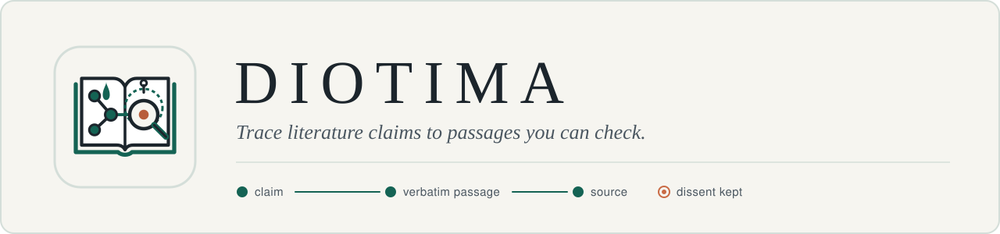

<p align="center">
  <picture>
    <source media="(prefers-color-scheme: dark)" srcset="assets/banner-dark.svg">
    
  </picture>
</p>

<p align="center">
  <a href="https://github.com/Wulfgardr/diotima/actions/workflows/ci.yml"></a>
  
  
  
</p>

Diotima is an open-source plugin for Claude Code and Codex, designed to connect literature claims to source passages and record whether they come from full text or an abstract. Your agent reads and reasons using your own AI subscription; Diotima provides the method, deterministic checks and statistics. Personal API keys are optional.

Diotima is pre-alpha. Passage lookup, file integrity checks and recheck sample planning work today. Literature search, full-text retrieval and the evidence meter are planned.

> **Not clinical decision support.** Diotima checks what sources say. It does not give medical advice.

## Why

A literature answer can misstate a number or extend a result beyond the group studied. In a pilot audit of answers from commercial tools, a confidence interval was copied wrongly, a subgroup result was presented as general, and a causal mechanism was attributed to sources that did not state it. Diotima's method records the passage and reading depth behind each claim so readers can check the trail themselves. A matching passage establishes that the text exists; interpreting what it supports still requires judgment.

## How to read a Diotima report

| | Verdict | Meaning |
|:-:|---|---|
|  | `supports` | Source supports the claim |
|  | `partial` | Source partially supports the claim |
|  | `contradicts` | Source contradicts the claim |
|  | `insufficient` | Passage too thin to judge the claim |
|  | `not verifiable` | Claim could not be verified |

| | Evidence trail | Meaning |
|:-:|---|---|
|  | verified passage | Passage found in source, with offsets and the source SHA-256 |
|  | full text | Based on full text |
|  | abstract only | Based on abstract only; quantitative claims stay unverified |

## What it does today

| Tool / skill | What it does |
|---|---|
| `/diotima:verify` | Check an existing answer claim by claim against its sources |
| `/diotima:search` | Answer a research question (manual mode until search tools land) |
| `find_passage` | Checks that a quote appears verbatim in a source (tolerates only typography and whitespace); returns offsets and the source SHA-256 |
| `check_file_integrity` | Verifies a frozen source file against its expected SHA-256 |
| `plan_recheck_sample` | Exact Beta-Binomial planning of how many claims a human must re-check |

Planned: literature search over open databases, open-access full text, numeric and CI checks,
and an open evidence meter with visible weights. See [docs/roadmap.md](docs/roadmap.md).

## Install

Requires [uv](https://docs.astral.sh/uv/): the MCP server is a small Python package.
Diotima is meant to be switched on when you need it, so it costs nothing in other sessions.

**Claude Code**

```sh
claude plugin marketplace add Wulfgardr/diotima
# only in the folder where you do research:
cd ~/research && claude plugin install diotima@diotima --scope project
# or for a single session, from a clone:
claude --plugin-dir /path/to/diotima
```

**Codex**

```sh
codex plugin marketplace add Wulfgardr/diotima
codex plugin add diotima@diotima
```

Then set `enabled = false` under `[plugins."diotima@diotima"]` in `~/.codex/config.toml`
and turn it on where you need it, either per project in `<project>/.codex/config.toml`:

```toml
[plugins."diotima@diotima"]
enabled = true
```

or for one session:

```sh
codex -c 'plugins={"diotima@diotima"={enabled=true}}'
```

## Develop

```sh
uv sync
uv run pytest
uv run ruff check .
python3 scripts/check_publication.py   # nothing copyrighted or private may be committed
python3 scripts/build_brand.py         # regenerate glyphs and banners from assets/brand.json
```

`src/diotima/legacy/` holds the reference engines from the research dossier (v0.3-v0.5, Italian
identifiers) with their original deterministic suites; new public modules are built around them.

The name comes from Diotima of Mantinea, who in Plato's *Symposium* teaches through questions.

## License

Apache-2.0. See [LICENSE](LICENSE) and [NOTICE](NOTICE).
